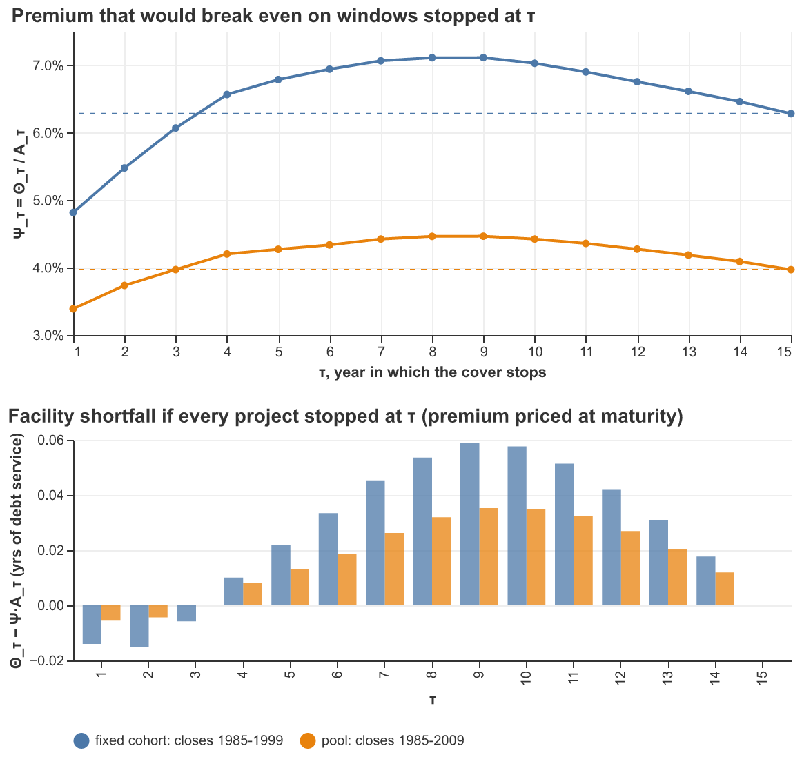
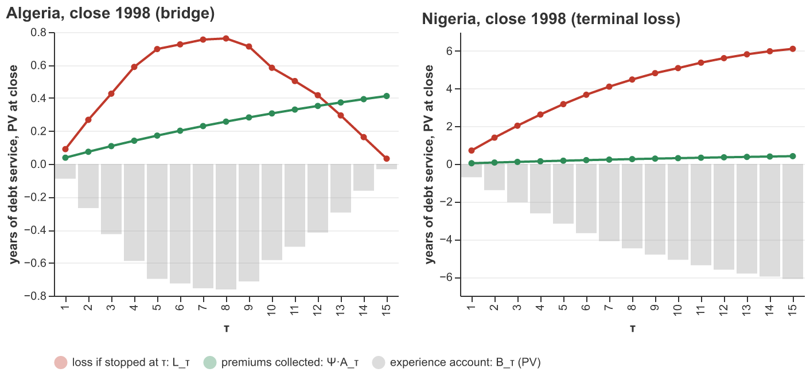
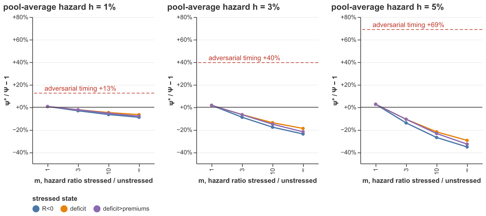
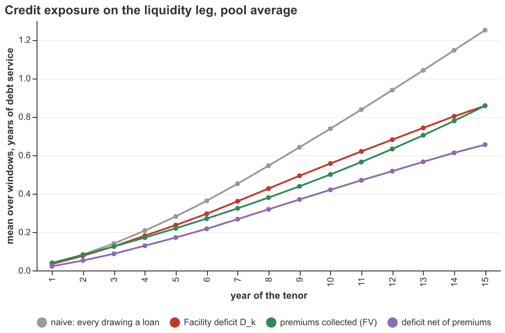
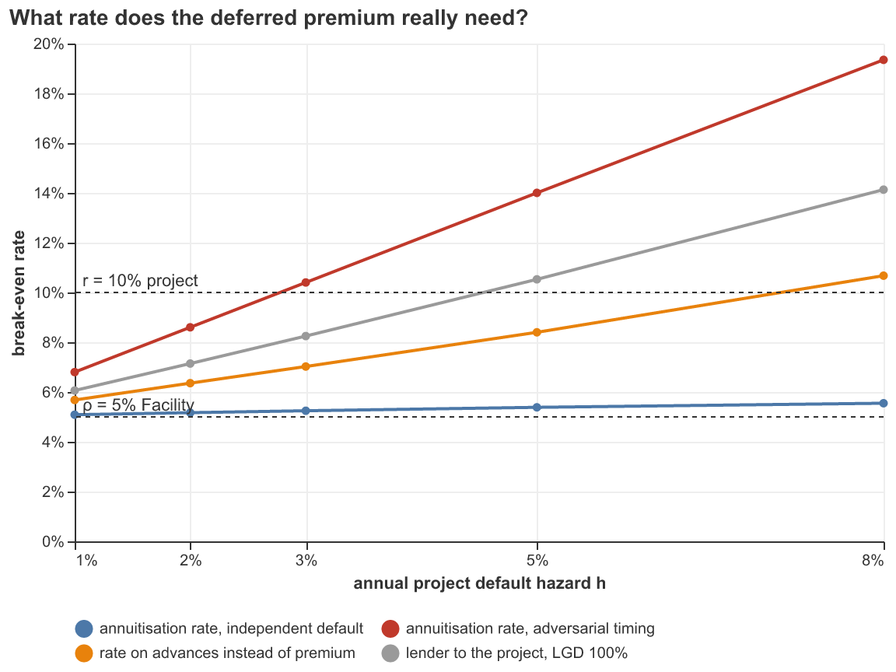
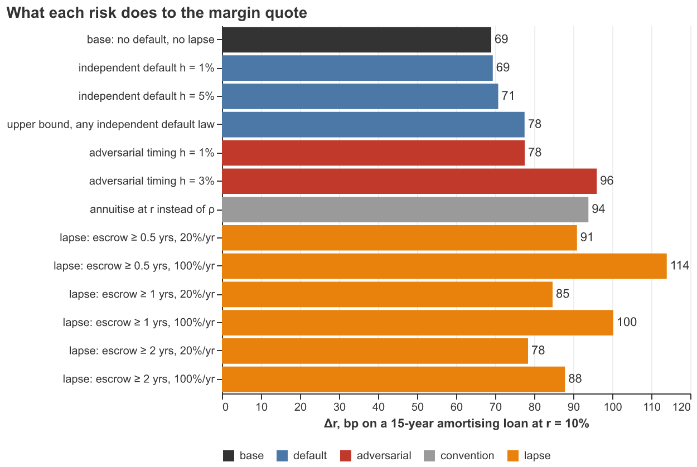

# Project default, the deferred premium, and the liquidity leg

*Companion to `rate_separation_20260917.md`. Analysis only — nothing here is in the draft yet. Code: `source/default_risk.py` (analysis, doctested) and `source/default_risk_charts.py` (figures). Full numerical output: `output/default_risk_results.txt`.*

The draft prices the cover as if every window runs to maturity, and then annuitises the expected loss at the Facility's rate $\rho$ rather than at the project's cost of capital $r$. It defends that choice in one sentence (end of *The actuarially fair premium*): if the project fails early, the Facility "will not risk any loss". That sentence is wrong as written: a project that fails while the experience account is in deficit leaves the Facility holding the deficit. This note asks how much that matters, in two forms:

1. **Annuitisation risk.** Charging $\Theta$ as a level annuity at $\rho$ instead of up front exposes the Facility to a project that stops paying before it has paid for its own loss.
2. **Credit risk on the liquidity leg.** Every advance is, in effect, a loan to a project that can fail for reasons the cover does not price.

**Headline.** The two questions are one calculation, because a project failure *replaces* the Facility's terminal liability rather than adding to it. Once that is written down, the evidence is strongly on the side of the draft's convention:

- For **any** default law independent of the $X$ path, the break-even premium lies between the smallest and largest premium on the same windows cut short at year $\tau$: **3.39% ≤ ψ\* ≤ 4.47%** of debt service, against 3.97% at maturity. In margin terms: **at most 78bp against 69bp**.
- At a realistic annual default hazard of 1–5%, the premium rises by **0.6–2.6%** (69→71bp). The rate at which the Facility should annuitise is **5.1–5.4%**, against a 6–10.5% rate for a lender carrying the same default risk.
- Making default more likely when the project is under stress **lowers** the break-even premium in every version tested. The Facility's deficits sit overwhelmingly in windows that end short anyway (92% of deficit dollar-years), so an early failure cuts off a loss that would otherwise have kept growing.
- Your two proposed arguments — drawings met out of the project's own escrow, and deficits already covered by premiums — are **true but modest**. Together they cut the credit exposure to 56% of a naive lender's. On their own they do not get the required rate far below $r$; the replacement mechanism does.
- **What is not small: lapse.** If projects whose escrow has built up can refinance and leave, Δr rises to 78–114bp. That is an order of magnitude more than default. It is a contract-design problem, not a discount-rate problem.

---

## 1. Variables

The draft's notation throughout, plus the objects this note adds.

| Symbol | Meaning | Unit | Code |
|---|---|---|---|
| $w=(i,\underline t)$ | window: country $i$, financial close $\underline t$, maturity $\underline t+n$ | — | `keys` row |
| $n$ | tenor, 15 | years | `n` |
| $k$ | elapsed year in the window, $1..n$ | years | `k` |
| $R_{w,k}$ | cumulative return on $X$ since close: the year-$k$ P&L per unit of debt service. $R<0$ is a drawing, $R>0$ a surplus | debt service | `F[:, k-1]` |
| $\rho$ | Facility's valuation rate, 5% | %/yr | `rho` |
| $r$ | project's hard-currency loan rate, 10% | %/yr | `r` |
| $c^-$, $c^+$ | carry on the experience account while in deficit (charged on advances) and while in surplus (earned on escrow); both $=\rho$ unless stated | %/yr | `c_neg`, `c_pos` |
| $A_{\tau}$ | $A_{\tau,\rho}=\sum_{k\le\tau}(1+\rho)^{-k}$ | years | `cover.annuity` |
| $B_{w,k}$ | experience-account balance at the end of year $k$, after the year's flow | debt service | `book["B"]` |
| $D_{w,k}$ | Facility deficit, $\max(-B_{w,k},0)$ | debt service | `book["D"]` |
| *own*, *fac* | the part of a drawing met out of a positive balance (the project's own escrow) and the part met with Facility cash | debt service | `book["own"]`, `book["fac"]` |
| *rep* | the part of a surplus that repays an outstanding deficit | debt service | `book["rep"]` |
| $V_{w,\tau}$ | net cover balance of window $w$ **truncated at $\tau$**: $\sum_{k\le\tau}R_{w,k}(1+\rho)^{-k}$. $V_{w,n}=V_w$ | yrs of debt service | — |
| $L_{w,\tau}$ | Facility's loss if the cover stops at the end of year $\tau$: PV at close of its net lending up to $\tau$ (§2) | yrs of debt service | `book["L"]` |
| $\Theta_\tau$ | $\frac1N\sum_w L_{w,\tau}$; $\Theta_n=\Theta=0.412$ | yrs of debt service | `curve.theta` |
| $\Psi_\tau$ | $\Theta_\tau/A_\tau$: the level premium that breaks even if *every* project stops at $\tau$; $\Psi_n=\Psi=3.97\%$ | share of debt service | `curve.psi` |
| $h$ | annual hazard of project failure for reasons outside the cover | %/yr | `h` |
| $f_{w,\tau}$ | probability that window $w$'s cover stops at $\tau$ (default in year $\tau$, or survival when $\tau=n$) | — | `stop_weights` |
| $\psi^*$ | break-even level premium once stopping is priced | share of debt service | `fair_premium` |
| $d_{\text{eff}}$ | the annuitisation rate that turns $\Theta$ into $\psi^*$: $\Theta/A_{n,d_{\text{eff}}}=\psi^*$. The rate the Facility is *effectively* charging on the deferred premium | %/yr | `implied_rate` |
| $\Pi_k$ | premiums collected by year $k$, carried forward at $\rho$: $\Psi\,\frac{(1+\rho)^k-1}{\rho}$ | debt service | `prem_acc` |

Pool throughout: the draft's 1985 pool, every rolling 15-year window in the WDI panel with Lesotho excluded, **1,055 windows in 50 countries**, closes 1985–2009.

---

## 2. The mechanism: a project failure replaces the terminal loss

### 2.1 Timing

Each year $k$ the account accrues, then the year's flow lands on it. A drawing is met first out of a positive balance (that is the project's own escrow coming back) and only the remainder is Facility cash. A surplus first repays any outstanding deficit and only the remainder is escrowed. This is the existing `cover._run_account` ledger, vectorised.

A project that fails "at $\tau$" has made its year-$\tau$ payment, with the Facility's help if $R_{w,\tau}<0$, and paid its year-$\tau$ premium alongside. It fails before year $\tau+1$. The cover is then extinguished: the Facility keeps the premiums it has, writes off the deficit it holds, and owes nothing at maturity. A positive balance is the project's money and goes to its creditors; it is neutral to the Facility.

### 2.2 The Facility's position at a stop

The Facility's own cash is the advances it funds and the repayments it receives. Escrow is project money, and moving it in and out is neutral. So its PV at close, for window $w$ stopped at $\tau$, is

$$
\Pi(w,\tau)\;=\;\Psi\,A_\tau\;-\;L_{w,\tau},
\qquad
L_{w,\tau}\;\equiv\;\sum_{k\le\tau}(1+\rho)^{-k}\big(\textit{fac}_{w,k}-\textit{rep}_{w,k}\big).
$$

When the account carries at $\rho$ on both sides, the deficit telescopes: $D_k=D_{k-1}(1+\rho)+\textit{fac}_k-\textit{rep}_k$, so

$$
L_{w,\tau}=(1+\rho)^{-\tau}D_{w,\tau}=(1+\rho)^{-\tau}\max(-B_{w,\tau},0)=\max(-V_{w,\tau},0).
$$

**The loss from a failure at $\tau$ is exactly the ultimate net loss of the same window, truncated at $\tau$.** At $\tau=n$ it is the paper's loss, and the code asserts this to machine precision for all 1,055 windows. "Conditional on early default" therefore has a precise empirical counterpart: the truncated curve $\Theta_\tau$ on the same windows.

(With $c^-\neq\rho$ the identity picks up the spread income, $L_{w,\tau}=(1+\rho)^{-\tau}D_{w,\tau}-(c^--\rho)\sum_{k\le\tau}(1+\rho)^{-k}D_{w,k-1}$. §6 uses this.)

### 2.3 Why this is not double counting

It is tempting to think of default risk as a loss *on top of* $\Theta$. It is not. In a window that fails at $\tau$, the Facility never faces the terminal loss $L_{w,n}$; it faces $L_{w,\tau}$ instead, and it has collected $\Psi A_\tau$ instead of $\Psi A_n$. The only question is whether the swap $(L_{w,n},\Psi A_n)\to(L_{w,\tau},\Psi A_\tau)$ is favourable to the Facility on average. That is what the rest of this note measures.

---

## 3. Annuitisation risk: the bound from shorter maturities

### 3.1 The result

With a stop time independent of the $X$ path, with probabilities $f_\tau$ summing to one over $\tau=1..n$, the Facility breaks even when $\sum_\tau f_\tau(\psi A_\tau-\Theta_\tau)=0$, i.e.

$$
\psi^*\;=\;\frac{\sum_\tau f_\tau\,\Theta_\tau}{\sum_\tau f_\tau\,A_\tau}
\;=\;\sum_\tau \omega_\tau\,\Psi_\tau,
\qquad
\omega_\tau=\frac{f_\tau A_\tau}{\sum_s f_s A_s},\quad\sum_\tau\omega_\tau=1 .
$$

**The break-even premium is a weighted average of the truncated-tenor premiums.** So, whatever the default law,

$$
\min_\tau\Psi_\tau\;\le\;\psi^*\;\le\;\max_\tau\Psi_\tau ,
$$

and the shorter-maturity losses bound the cost of annuitising at $\rho$ directly. The weights are the annuity-weighted stop probabilities, so long survivals count for more than early failures. At $h=1\%$, 92% of the weight is on maturity; at $h=5\%$, 65%.

| $h$ | $\omega_n$ (weight on maturity) | $\sum_{\tau\le7}\omega_\tau$ |
|---|---|---|
| 1% | 0.92 | 0.02 |
| 3% | 0.78 | 0.07 |
| 5% | 0.65 | 0.13 |
| 8% | 0.49 | 0.21 |

### 3.2 The truncated curve



*Top: $\Psi_\tau$, the premium that breaks even if every window stops at $\tau$, with the maturity premium dashed. Bottom: the Facility's shortfall per window, $\Theta_\tau-\Psi A_\tau$, if every project stopped at $\tau$ and the premium had been set for maturity.*

Pool, same 1,055 windows cut at $\tau$:

| $\tau$ | $A_\tau$ | $\Theta_\tau$ | $\Psi_\tau$ | $P(L_{w,\tau}>0)$ | shortfall $\Theta_\tau-\Psi A_\tau$ |
|---|---|---|---|---|---|
| 1 | 0.952 | 0.032 | 3.39% | 37.6% | −0.006 |
| 2 | 1.859 | 0.070 | 3.74% | 35.9% | −0.004 |
| 3 | 2.723 | 0.108 | 3.97% | 35.8% | 0.000 |
| 4 | 3.546 | 0.149 | 4.20% | 34.2% | +0.008 |
| 5 | 4.330 | 0.185 | 4.27% | 33.2% | +0.013 |
| 6 | 5.076 | 0.220 | 4.34% | 32.6% | +0.019 |
| 7 | 5.786 | 0.256 | 4.42% | 32.2% | +0.026 |
| 8 | 6.463 | 0.289 | 4.46% | 31.8% | +0.032 |
| 9 | 7.108 | 0.318 | **4.47%** | 31.2% | **+0.035** |
| 10 | 7.722 | 0.342 | 4.42% | 30.6% | +0.035 |
| 11 | 8.306 | 0.362 | 4.36% | 29.6% | +0.032 |
| 12 | 8.863 | 0.379 | 4.27% | 28.8% | +0.027 |
| 13 | 9.394 | 0.393 | 4.19% | 28.3% | +0.020 |
| 14 | 9.899 | 0.405 | 4.09% | 27.4% | +0.012 |
| 15 | 10.380 | 0.412 | 3.97% | 26.3% | 0.000 |

Fixed cohort, closes 1985–1999 only (the crisis-heavy vintages):

| $\tau$ | 1 | 2 | 3 | 4 | 5 | 6 | 7 | 8 | 9 | 10 | 11 | 12 | 13 | 14 | 15 |
|---|---|---|---|---|---|---|---|---|---|---|---|---|---|---|---|
| $\Psi_\tau$ | 4.82 | 5.48 | 6.07 | 6.57 | 6.79 | 6.94 | 7.07 | 7.11 | **7.12** | 7.03 | 6.90 | 6.76 | 6.62 | 6.46 | 6.28 |

**Reading it.**

- **The curve is hump-shaped, not decreasing.** Early failures *favour* the Facility. In the first two or three years the premium arrives faster than the deficit builds, because the deficit is a sum of small early shortfalls while the premium is a level stream. The deficit catches up by year 4 and the shortfall peaks at $\tau\approx9$, before the late recoveries of the bridge windows start to pull $\Theta_\tau$ back below $\Psi A_\tau$.
- **The intuition that "conditional on early default the loss is higher" is right in the middle of the tenor and wrong at the start.** Its size is bounded: at worst 12.6% above $\Psi$ on the pool (4.47/3.97) and 13.4% on the crisis cohort (7.12/6.28). The relative bound is the same on both samples, which suggests it is a property of the shape of $X$ paths rather than of any particular episode.
- **The shortfall in absolute terms** is at most 0.035 years of debt service per window on the pool (0.059 on the cohort), against $\Theta=0.41$.

### 3.3 Relation to the tenor figure in `paper_draft.ipynb`

The tenor section of `paper_draft` compares windows of *different lengths*: $n$-year windows for $n=5..25$, each priced at its own maturity. That answers "what does a shorter loan cost to cover". The default question needs the *same* windows cut short, because a project that fails at year 8 of a 15-year loan has a 15-year close date, a 15-year sample and an 8-year history. The two curves are close in level where they overlap:

| $\tau$ | $\Psi_\tau$, 15-yr windows truncated | $\Psi$, all $\tau$-year windows | $N_\tau$ |
|---|---|---|---|
| 3 | 3.97% | 3.79% | 1,666 |
| 5 | 4.27% | 4.18% | 1,564 |
| 8 | 4.46% | 4.52% | 1,411 |
| 10 | 4.42% | 4.60% | 1,309 |
| 12 | 4.27% | 4.26% | 1,207 |
| 15 | 3.97% | 3.97% | 1,055 |

(On the fixed cohort the truncated $\Psi_5=6.79\%$ matches the paper's 6.8% at $n=5$.) So the paper's tenor evidence can be cited for the bound, but the truncated curve is the object to quote, because it holds the sample fixed by construction.

### 3.4 Two windows from the draft



*Grey bars: the experience-account balance, discounted to close. Red: $L_{w,\tau}$, the Facility's loss if the project failed at $\tau$. Green: the premiums it would have collected by then, $\Psi A_\tau$.*

- **Algeria, close 1998** (the draft's opening example) is a bridge. It ends essentially level, with $L_{w,15}=0.03$, but the deficit peaks at 0.76 years of debt service in year 8. A failure there costs the Facility 0.76 against 0.26 of premium collected: a net 0.50. **This is the case your concern is about, and it is real at the level of the single window.** It is also exactly the case the bound averages over: windows like this are what lift the middle of the curve in §3.2.
- **Nigeria, close 1998**, into the 1999 abandonment of the peg, is a terminal loss. The deficit deepens every year to −6.1. Any failure before maturity *saves* the Facility money, by up to 6 years of debt service.

The pool is a mixture of these two shapes. The bound says how they net out when default timing is unrelated to $X$. §4 asks what happens when it is not.

### 3.5 Independent default at realistic hazards

| $h$ | $P(\text{fail before }n)$ | $\psi^*$ | uplift on $\Psi$ | $\Delta r$ at $r=10\%$ | $d_{\text{eff}}$ | lender's rate on the same hazard, $\frac{1+\rho}{1-h}-1$ |
|---|---|---|---|---|---|---|
| 0 | 0% | 3.97% | — | 69bp | 5.00% | 5.0% |
| 1% | 13% | 3.99% | +0.6% | 69bp | 5.09% | 6.1% |
| 2% | 25% | 4.02% | +1.2% | 70bp | 5.17% | 7.1% |
| 3% | 35% | 4.04% | +1.7% | 70bp | 5.25% | 8.3% |
| 5% | 51% | 4.07% | +2.6% | 71bp | 5.38% | 10.5% |
| 8% | 69% | 4.12% | +3.7% | 72bp | 5.55% | 14.1% |
| any law | — | ≤ 4.47% | ≤ +12.6% | ≤ 78bp | ≤ 6.8% | — |

The last two columns compare like with like. $d_{\text{eff}}$ is the rate at which the Facility should turn $\Theta$ into a level annuity once default is priced. The lender's rate is what someone financing $\Theta$ up front would need on a loan to a project with the same hazard and nothing recovered. **At a 5% annual hazard — one project in two failing before maturity — the right annuitisation rate is $\rho$ plus 38bp, while the lender needs $\rho$ plus 550bp.** The draft's claim that the Facility should annuitise near its own rate, not near $r$, holds by a wide margin.

*On calibration.* These hazards are assumptions, not estimates. As orientation: rating-agency studies of project-finance bank loans report cumulative 10-year default rates in the high single digits, which is $h\approx1\%$. A 10% hard-currency coupon over a ~4–5% dollar risk-free rate bounds the market-implied hazard at roughly 5–6% at full loss given default — and that coupon already prices the FX risk the cover removes. **Verify the PF default figures against the source before quoting them in the paper.**

---

## 4. Wrong-way default

### 4.1 The stresses

Default is likely to be correlated with $X$: the shocks that devalue the currency also hit the offtaker and demand. Three definitions of a "stressed" window-year, each with the hazard $m$ times higher in stressed years than in unstressed ones, and the pool-average hazard held at $h$. So $m$ moves *when* projects fail, not *how many* fail.

- **R<0** — the project is drawing that year (macro stress).
- **deficit** — the experience account is in deficit ($D_{w,k}>0$): the Facility has money out.
- **deficit>premiums** — the deficit exceeds the premiums collected ($D_{w,k}>\Pi_k$): the Facility is net exposed. This is the stress aimed most directly at the Facility.

$m=\infty$ puts every failure in a stressed year.

Separately, an **adversarial bound**. Each project fails before maturity with probability $q=1-(1-h)^{n-1}$, independently of its path, but in the year of its window that hurts the Facility most, $\arg\max_\tau(L_{w,\tau}-\psi A_\tau)$. No hazard law, however correlated with $X$, can do worse for a given incidence. It assumes the timing of failure knows the future of $X$, so treat it as a ceiling, not a scenario.

### 4.2 Results



Premium uplift $\psi^*/\Psi-1$:

| stressed state, $m$ | $h$=1% | 2% | 3% | 5% | 8% |
|---|---|---|---|---|---|
| any state, $m=1$ (independent) | +0.6% | +1.1% | +1.7% | +2.6% | +3.7% |
| R<0, $m=3$ | −3.2% | −6.1% | −8.9% | −14.0% | −20.3% |
| R<0, $m=10$ | −6.5% | −12.4% | −17.7% | −26.9% | −37.5% |
| R<0, $m=\infty$ | −8.9% | −16.8% | −23.8% | −35.3% | −47.9% |
| deficit, $m=3$ | −2.2% | −4.4% | −6.6% | −10.7% | −16.4% |
| deficit, $m=10$ | −4.8% | −9.4% | −13.8% | −21.9% | −32.3% |
| deficit, $m=\infty$ | −6.6% | −12.9% | −18.9% | −29.5% | −42.3% |
| deficit>premiums, $m=3$ | −2.3% | −4.5% | −6.7% | −10.7% | −16.1% |
| deficit>premiums, $m=10$ | −5.4% | −10.4% | −15.1% | −23.4% | −33.3% |
| deficit>premiums, $m=\infty$ | −8.0% | −15.3% | −21.8% | −32.8% | −44.8% |
| **adversarial timing** | **+12.5%** | **+25.7%** | **+39.6%** | **+69.0%** | **+116%** |

Implied annuitisation rate $d_{\text{eff}}$ for the same cases: 5.09–5.55% independent; **below $\rho$** (0–4.7%) for every wrong-way stress; 6.8%, 8.6%, 10.4%, 14.0% and 19.4% adversarial.

### 4.3 Why wrong-way default helps the Facility

This is the counter-intuitive result, and it has to be explained before it is used. The deficits are concentrated in the windows that lose anyway:

| | share |
|---|---|
| deficit window-years that sit in windows ending short | 69.4% |
| deficit **dollar**-years that sit in windows ending short | **91.9%** |
| Facility cash advanced in windows ending short | 87.8% |
| Facility cash repaid inside the window (undiscounted, incl. accrued carry) | **24.2%** |
| in short windows: deficit years where $L_{w,\tau}<L_{w,n}$ | 71.6% |

When the Facility has money out, the typical situation is Nigeria 1998, not Algeria 1998: a deficit that is still deepening and will not come back. A failure in such a year stops the loss there. Concentrating failures in stressed years therefore mostly truncates the losing windows, while the bridge windows, which spend fewer years in deficit, survive and pay their full premium.

Two conditions carry this result, and the draft should state them if it uses it:

1. **Failure must extinguish the cover.** The Facility has no further obligation after the project fails. This is true by design here: the cover is an option on the project's debt service, and there is no debt service after failure.
2. **Failure must not be chosen.** If the project, rather than nature, decides when the cover ends, it will pick the adversarial year. In a bridge window that is mid-deficit, the project gains by walking away from the sweep and keeping its later surplus. See §8.2.

The adversarial row is the honest ceiling. At $h=1\%$ it adds 9bp (69→78). At $h=3\%$ it is about the same as annuitising at $r$: 96bp against 94bp.

---

## 5. Credit risk on the liquidity leg: your two observations

### 5.1 The decomposition

Over all 15,825 window-years in the pool:

| | value |
|---|---|
| window-years with a drawing ($R<0$) | 31.1% |
| of which met **wholly** out of the project's own escrow | 19.9% |
| share of drawn **dollars** met out of escrow | 13.5% |
| window-years with a Facility deficit ($D>0$) | 31.7% |
| of which the deficit is no larger than premiums collected ($D\le\Pi_k$) | 23.7% |
| window-years in which the Facility advances new cash | 24.9% |
| of which the deficit then exceeds premiums collected | 81.6% |
| mean exposure of a naive lender funding every drawing, no netting | 0.580 |
| mean Facility deficit $D$ | 0.432 |
| mean deficit net of premiums collected, $\max(D-\Pi,0)$ | 0.325 |
| … as a share of the naive lender's exposure | **56%** |
| … as a share of the Facility's deficit | 75% |

(Exposures in years of debt service, averaged over window-years.)



*Mean exposure by year of the tenor. Grey: a lender funding every drawing. Red: the Facility's actual deficit, net of the project's escrow. Green: premiums collected to date. Purple: the deficit net of premiums.*

By year:

| $k$ | $P$(draw) | $P(D>0)$ | $P(D>\Pi)$ | naive | $D$ | $\Pi_k$ | net |
|---|---|---|---|---|---|---|---|
| 1 | 0.376 | 0.376 | 0.230 | 0.034 | 0.034 | 0.040 | 0.022 |
| 3 | 0.342 | 0.358 | 0.260 | 0.140 | 0.125 | 0.125 | 0.087 |
| 5 | 0.318 | 0.332 | 0.261 | 0.281 | 0.236 | 0.219 | 0.171 |
| 8 | 0.342 | 0.318 | 0.258 | 0.545 | 0.426 | 0.379 | 0.318 |
| 10 | 0.313 | 0.306 | 0.237 | 0.738 | 0.556 | 0.499 | 0.420 |
| 12 | 0.277 | 0.288 | 0.226 | 0.938 | 0.680 | 0.632 | 0.517 |
| 15 | 0.210 | 0.263 | 0.213 | 1.250 | 0.857 | 0.857 | 0.654 |

### 5.2 Verdict on the two arguments

- **"Not every R<0 is lending."** True but small. One drawing year in five is met wholly out of escrow, but only 13.5% of drawn dollars. Escrow builds in windows that start well. Most of the money drawn is drawn early in windows that start badly, before there is any escrow to draw on.
- **"The Facility is already compensated by past premiums."** Also true but small. Only 24% of deficit years are fully covered by premiums collected, and in 82% of the years the Facility advances new cash, the deficit then exceeds premiums. Note that on *average* the pool's premiums collected track the average deficit almost exactly (green against red in the figure). That is $\Theta=\Psi A_n$ reappearing year by year, not a cushion inside each window: the premiums come from every window and the deficits from a third of them.

Taken together, the two arguments bring the Facility's credit exposure to **56% of a naive lender's**. A spread of $h\times56\%$ on top of $\rho$ would be the rate implied by these two arguments alone: 7.95% at $h=5\%$. That is below $r$, but not far below it. And it double counts, because it uses the same premium both to pay for the terminal loss and as a cushion against default.

**What actually bounds the rate is the third mechanism (§2.3): default cancels the terminal loss.** The deficits the Facility carries mostly belong to windows whose terminal loss is already in $\Theta$. A failure in one of them does not add a credit loss to the macro loss — it *is* the macro loss, arriving early and smaller. That is why §3.5 gets $d_{\text{eff}}=5.38\%$ at $h=5\%$, where the exposure arithmetic alone gets 7.95%.

**Suggested framing for the draft.** Lead with the replacement identity and the bound. Use escrow and the premium cushion as supporting colour, not as the argument.

---

## 6. Price default risk in the premium, not in the rate on advances

The alternative design charges a carry $c^->\rho$ on the Facility's advances (the EcoInvest-style lending spread raised in `rate_separation`, §1) and keeps the premium at $\Psi$. The table gives the advance rate that breaks even:

| $h$ | Facility shortfall at $c^-=\rho$ (yrs per window) | break-even $c^-$ | spread over $\rho$ | memo: premium route, $d_{\text{eff}}$ |
|---|---|---|---|---|
| 1% | 0.0023 | 5.68% | 68bp | 5.09% |
| 2% | 0.0042 | 6.36% | 136bp | 5.17% |
| 3% | 0.0058 | 7.02% | 202bp | 5.25% |
| 5% | 0.0081 | 8.40% | 340bp | 5.38% |
| 8% | 0.0099 | 10.67% | 567bp | 5.55% |



The same shortfall costs about **nine times as much in rate** when recovered on the advances. The spread accrues on balances that are mostly never repaid (only 24% of Facility cash comes back inside the window), so most of it is booked and then written off with the deficit. The premium is collected from every window, including the 74% that never put the Facility out of pocket at maturity. **A lending spread on the liquidity leg is a weak lever, and the draft should not lean on it.**

---

## 7. Everything on one scale



| case | $\Delta r$ (bp, $r=10\%$) |
|---|---|
| base: no default, no lapse | 69 |
| independent default, $h=1\%$ / $5\%$ | 69 / 71 |
| upper bound, any independent default law | 78 |
| adversarial timing, $h=1\%$ / $3\%$ | 78 / 96 |
| annuitise at $r$ instead of $\rho$ | 94 |
| lapse once escrow ≥ 2 yrs, 20%/yr / 100%/yr | 78 / 88 |
| lapse once escrow ≥ 1 yr, 20%/yr / 100%/yr | 85 / 100 |
| lapse once escrow ≥ 0.5 yrs, 20%/yr / 100%/yr | 91 / 114 |

**The cost of annuitising at $\rho$ under involuntary default is a rounding error. The cost of letting good projects leave is not.**

---

## 8. Remaining problems with discount rates (and a neighbouring one)

Ordered by how much they move the quoted number, largest first.

### 8.1 The draft mixes two loan rates in its $\Delta r$ quotes

The notebook sets `r = 0.10`, and the pool table quotes **69bp**. But several numbers in the prose were carried over from `paper_draft`, where $r=\rho=5\%$:

| where | quoted | at $r=5\%$ | at $r=10\%$ |
|---|---|---|---|
| *Equivalent interest rate spread*, Nigeria | 1.2% | 101bp | **120bp** ✓ |
| *Cost of cover for the pool*, table | 69bp | 58bp | **69bp** ✓ |
| same section, priced on $Q$ | 144bp | **143bp** ✗ | 170bp |
| *Country by country*: pool | 58bp → 55bp → 30bp | ✗ | — |
| *Country by country*: median, Libya, DRC, Ethiopia, Algeria, Gambia, Nigeria (101bp) | various | ✗ | — |

The $Q$ figure and the whole country section are at $r=5\%$. All of them rise by roughly 19% when restated at 10%. Either re-run the country section at $r=10\%$ or state the loan rate on each quote. (The lump-sum comparison in *The actuarially fair premium*, $\Theta/A_{15,10\%}=9.4\%$, is consistent.)

### 8.2 Lapse and voluntary termination — the large one

Treated in `rate_separation` §6 as a remark; now measured. If a project whose escrow has reached $x$ years of debt service leaves the cover with probability $p$ per year (refinancing, prepaying, or simply ceasing to pay), it takes its escrow and owes nothing. The Facility loses the premiums that were paying for the losing windows:

| escrow ≥ | $p$/yr | $\psi^*$ | uplift | $\Delta r$ |
|---|---|---|---|---|
| 2 yrs | 20% | 4.52% | +14% | 78bp |
| 2 yrs | 100% | 5.07% | +28% | 88bp |
| 1 yr | 20% | 4.88% | +23% | 85bp |
| 1 yr | 100% | 5.79% | +46% | 100bp |
| 0.5 yrs | 20% | 5.25% | +32% | 91bp |
| 0.5 yrs | 100% | 6.59% | +66% | 114bp |

There is a mirror-image risk: **strategic exit in deficit.** A project mid-way through a bridge window (Algeria 1998 at year 8) gains by walking away from the sweep, keeping its future surpluses and leaving the Facility with the deficit. That is precisely the adversarial case of §4, chosen rather than suffered.

Contract fixes: premium mandatory for the loan life, payable on prepayment as a make-whole; the sweep obligation survives termination until the deficit is repaid or maturity is reached; perhaps a subordinated claim on the project for an outstanding deficit at a voluntary exit. Also note that a premium which is cheap *because* it is mandatory is an argument for the pool to be a programme with compulsory participation, which the draft already raises under adverse selection.

### 8.3 $\rho$ is doing two jobs

$\rho=5\%$ is used both as the Facility's funding cost and as its required return on risk. The pure premium at $\rho$ is defensible, as this note shows. But the loading for solvency capital — $(r_C-r_f)\times$ capital held — is still absent. That loading is where the difference between a donor-backed and a commercially-capitalised Facility shows up (`rate_separation` §6). This is now the most important *missing* rate in the paper.

### 8.4 One constant rate over 1985–2024

Dollar rates over the sample ran from ~1% to ~9%. A single $\rho$ is fine for the *premium*, because $\Psi$ is nearly invariant in $\rho$ (3.85–4.02% over $\rho=3$–12%, `rate_separation` §2). It matters more for $\Theta$ and capital. A sentence in the notation section suffices.

### 8.5 Escrow earning less than $\rho$ — not a problem

If the escrow earns a money-market rate below $\rho$, the account builds more slowly and covers fewer later drawings. The effect is negligible:

| $c^+$ | 5% | 4% | 3% | 2% | 0% |
|---|---|---|---|---|---|
| $\Theta$ | 0.4121 | 0.4135 | 0.4147 | 0.4159 | 0.4182 |
| $\Psi$ | 3.97% | 3.98% | 4.00% | 4.01% | 4.03% |

It can be dropped from the list of concerns.

### 8.6 Premium timing convention

The calculation takes the year-$\tau$ premium as paid by a project that fails at the end of year $\tau$. If premiums are instead paid in arrears and the failing project misses the last one, every early stop loses one premium, about $\Psi\times P(\text{fail})$ discounted. Over the hazard grid that is 0.9% of $\Theta$ at $h=1\%$, 2.4% at 3%, 3.6% at 5% and 5.0% at 8%: somewhat *larger* than the default uplift of §3.5 (+0.6% to +3.7%), so it roughly doubles it — still a few basis points, but the convention should be stated. It is not built into `fair_premium`; add a flag if the paper adopts payment in arrears.

### 8.7 What the hazard grid assumes

The hazard grid is uncalibrated (§3.5). The two-state wrong-way stresses are stylised. A calibrated version would tie $h_{w,k}$ to a covariate such as the depth of $R_{w,k}$ or the offtaker's arrears. The adversarial bound makes calibration matter less: whatever the correlation, the premium cannot exceed the adversarial row for the chosen incidence.

---

## 9. What I would port into the draft

1. Replace the last sentence of *The actuarially fair premium* ("the facility … will not risk any loss") with the replacement identity of §2.2 and the bound of §3.1. Fig. 1 is the evidence, and the Algeria/Nigeria pair of Fig. 2 carries the intuition using two windows the reader already knows.
2. One table: §3.5, independent hazards with $d_{\text{eff}}$ against the lender's rate. It is the cleanest statement of why $\rho$ and not $r$.
3. One paragraph on wrong-way default, with the concentration table of §4.3 and the adversarial ceiling. State the two conditions (failure extinguishes the cover; failure is not chosen).
4. The liquidity-leg decomposition of §5 as supporting colour, honestly sized at 56% of a naive lender's exposure.
5. Lapse moves from a remark to a design requirement, with the §8.2 table.
6. Fix the $r=5\%$ / $10\%$ mix (§8.1) before anything else is quoted.

## Reproducing

```bash
.venv/Scripts/python.exe source/default_risk.py          # all tables -> stdout (saved in output/default_risk_results.txt)
.venv/Scripts/python.exe source/default_risk_charts.py   # output/default_risk_fig*.png
.venv/Scripts/python.exe -m doctest source/default_risk.py
```

`default_risk.analysis(n, rho, r, start_year, hazards, multipliers)` returns every table as a DataFrame in a dict, plus the raw `keys`, `F` (window × year flows) and `book` (the vectorised ledger), so any cut above can be re-run on a sub-pool or at other rates.
