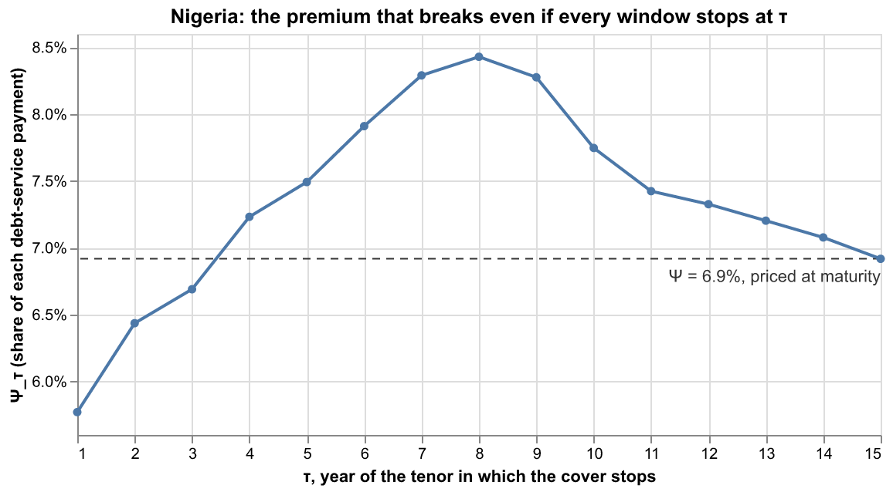

# Rewriting "The cost of the liquidity leg": default as part of the premium

*Proposal for cell 10 of `notebooks/draft.ipynb`. It supersedes the framing of `default_risk_20261004.md`, which kept annuitisation risk and liquidity-leg credit risk apart; the numbers there still stand. Code: `source/default_risk.py`, functions `stopped_curve`, `price_with_default` and `describe_default` (doctested).*

---

## 0. Is the observation correct?

**Yes. Annuitisation risk and credit risk on the liquidity leg are one event, and they should be treated as one.** A project that fails in year $\tau$ for a reason the cover does not price does two things at once: it stops paying premium, and it ends the cover. The Facility is left with $\tau$ premiums on one side and, on the other, the experience-account balance at $\tau$ if it is negative. It no longer faces the terminal balance at maturity. Both "risks" are just the swap

$$
\big(\Psi A_{n,\rho},\;\max(-V_w,0)\big)\;\longrightarrow\;\big(\Psi A_{\tau,\rho},\;\max(-V_{w,\tau},0)\big),
$$

and the only question is whether that swap costs the Facility money on average. That is a premium question, so it belongs inside the premium calculation. This is exactly the extension of the draft's logic you describe.

Three precise statements make the observation exact, and the cell should carry them:

1. **"Exactly equivalent to the up-front payment if the project reaches maturity."** True in present value at $\rho$, which is the Facility's own valuation rate: $\Psi A_{n,\rho}=\Theta$ by definition.
2. **"The loss is the momentary balance of the experience account, if negative."** True, and it equals the truncated net cover balance $\max(-V_{w,\tau},0)$ discounted to close, *because the account carries at $\rho$ in both directions*. If the account charged a different rate on deficits than $\rho$, a spread term would appear (`default_risk_20261004.md` §2.2). The draft sets carry $=\rho$, so the identity is exact; the code asserts it.
3. **"A slightly higher premium might be needed, if default increases the expected loss."** Right, and "might" is the right word, because the sign can go either way. Failures in the first three years *lower* the Facility's cost: premium arrives faster than the deficit builds. Failures mid-tenor raise it. With failures independent of $X$, the net effect is a small increase. If failures cluster in years when the account is in deficit, the net effect is a decrease.

(One small slip in the wording: the momentary balance is the loss *to the Facility*, not to the project.)

What the merge makes unnecessary: the two separate arguments of `default_risk_20261004.md` §5. A drawing met out of escrow creates no deficit, so it never enters $V_{w,\tau}$; premiums already collected are the $\Psi A_{\tau,\rho}$ on the other side. Both are inside the calculation automatically and need no prose of their own.

What it does **not** cover, and why the cell flags it: voluntary termination. A project that can *choose* when to stop — refinancing once its escrow has built up, or walking away from the sweep mid-deficit — is not a credit event, it is an option. It cannot be priced inside $\psi^*$ with an exogenous hazard. It has to be removed by contract.

---

## 1. The proposed markdown cell

```markdown
## The cost of the liquidity leg

The premium above prices the risk leg: the expected terminal balance of the experience account, on the assumption that the project reaches maturity. It is converted from the lump sum $\Theta$ into a level annual premium $\Psi$ with an annuity factor at the Facility's own rate $\rho$. That is the rate at which the Facility values its liability, and if the project reaches maturity the two forms of payment are worth exactly the same to it: $\Psi A_{n,\rho}=\Theta$.

The alternative would be to ask for $\Theta$ up front. The project would have to borrow it at its own cost of capital $r$: in excess of 10% for a Nigerian project, at which $A_{15,10\%}=7.61$, so that annual debt service would rise by 9.4% rather than 6.9%. The difference is the project's credit spread, charged on money the Facility does not need to lend.

But the annuity is not free of credit risk either, and neither is the liquidity leg. A project can fail for reasons the cover does not price --- construction, operations, offtaker arrears, its sponsor. If it fails, the premiums stop. And if it fails while it is drawing on the Facility, the advances outstanding are not repaid. These are not two risks but one event, and the premium calculation already contains everything needed to price it.

**A failure ends the cover.** Suppose the project fails at the end of year $\underline t+\tau$, having made its debt-service payment and its premium payment that year. The Facility's cover ends with it: there is no further debt service to support and no commutation at maturity. What the Facility is left with is the experience account as it stands. A positive balance is the project's money and goes to its creditors. A negative balance is written off, and is the Facility's loss. Because the account accrues at $\rho$, that balance discounted back to close is the net cover balance of the same window, cut off at $\tau$:
$$
V_{w,\tau} \;\equiv\; \sum_{t=\underline{t}+1}^{\underline{t}+\tau} \frac{R_{w,t}}{(1+\rho)^{t-\underline{t}}},
\qquad
\text{loss} \;=\; \bar\delta\,\max(-V_{w,\tau},0),
\qquad
\text{premiums collected} \;=\; \bar\delta\,\Psi A_{\tau,\rho}.
$$
A window that fails at $\tau$ is therefore priced exactly like one that survives, over a shorter tenor. A shortfall met out of the project's own escrow creates no deficit and so never enters $V_{w,\tau}$; premiums already paid are counted on the other side. Nothing needs to be added to the model.

**The premium if every window stopped at $\tau$.** Averaging over the pool as before gives the expected loss, and the level premium that would break even, if every project in the pool stopped in year $\tau$:
$$
\Theta_\tau \;\equiv\; \frac{1}{N}\sum_{w\in\mathcal{W}}\max(-V_{w,\tau},0),
\qquad
\Psi_\tau \;\equiv\; \frac{\Theta_\tau}{A_{\tau,\rho}},
\qquad
\Psi_n=\Psi .
$$
@fig-stopped-nga plots $\Psi_\tau$ for the 25 Nigerian windows. It is not monotone. A project that fails in its first years leaves the Facility *better* off than one that runs to maturity ($\Psi_1=5.8\%$ against $\Psi=6.9\%$): the premium is a level stream from the first year, while the deficit is built up out of the shortfalls one at a time. The deficit catches up by year 4, and the worst year to fail is the eighth, at $\Psi_8=8.4\%$, when the windows that run into the 1999 devaluation are deep in deficit and those that will recover have not yet started to. After that the recoveries pull $\Psi_\tau$ back down to $\Psi$.

**The premium with failures.** Let $f_\tau$ be the probability that the cover stops at the end of year $\tau$: failure in that year for $\tau<n$, and for $\tau=n$ failure in the last year or survival, which are the same thing to the Facility. Take $f$ to be the same for every window and independent of its path of $X$. The Facility breaks even when the expected premiums collected equal the expected loss, $\sum_\tau f_\tau\,(\psi^*A_{\tau,\rho}-\Theta_\tau)=0$, so
$$
\psi^* \;=\; \frac{\sum_{\tau=1}^{n} f_\tau\,\Theta_\tau}{\sum_{\tau=1}^{n} f_\tau\,A_{\tau,\rho}}
\;=\; \sum_{\tau=1}^{n}\omega_\tau\,\Psi_\tau ,
\qquad
\omega_\tau \;=\; \frac{f_\tau A_{\tau,\rho}}{\sum_{s} f_s A_{s,\rho}} .
$$
The premium with failures is a weighted average of the fifteen stopped-window premiums $\Psi_1,\dots,\Psi_n$. Each $\Psi_\tau$ is weighted by the probability that the cover stops in year $\tau$ times the premiums it would have collected by then, so long-lived covers count for more than short ones.

Two consequences. First, since the weights are non-negative and sum to one, whatever the law of the failure year,
$$
\min_{\tau}\Psi_\tau \;\le\; \psi^* \;\le\; \max_{\tau}\Psi_\tau ,
$$
where the minimum and maximum are taken over the fifteen possible years $\tau$ in which the cover can stop. For Nigeria this is $5.8\%\le\psi^*\le8.4\%$. The upper end is reached only if every project in the pool fails in year 8, which is as bad as any failure law independent of $X$ can be. Second, the weight on surviving to maturity, $\omega_n$, sharpens this considerably:
$$
\psi^*-\Psi \;=\; \sum_{\tau<n}\omega_\tau\,(\Psi_\tau-\Psi) \;\le\; (1-\omega_n)\,\big(\max_\tau\Psi_\tau-\Psi\big).
$$

With a constant annual hazard $h$, $f_\tau=(1-h)^{\tau-1}h$ for $\tau<n$ and $f_n=(1-h)^{n-1}$. For the Nigerian pool:

| annual hazard $h$ | fails before maturity | $\omega_n$ | $\psi^*$ | change on $\Psi$ | bound |
|---|---|---|---|---|---|
| 0 | 0% | 1.00 | 6.92% | --- | --- |
| 1% | 13% | 0.92 | 6.97% | +0.7% | +1.7% |
| 3% | 35% | 0.78 | 7.06% | +2.0% | +4.8% |
| 5% | 51% | 0.65 | 7.14% | +3.2% | +7.6% |
| 8% | 69% | 0.49 | 7.24% | +4.6% | +11.2% |

Even if half of all projects fail before maturity, for reasons that have nothing to do with the currency, the premium rises by 3%, from 6.9% to 7.1% of debt service. Put in terms of the choice that opened this section: annuitising $\Theta$ to 7.1% is the same as annuitising it at 5.5% rather than 5%, while a lender financing $\Theta$ up front against the same hazard would need about 10.5%. The Facility's own rate, with a thin margin for failure, is the right one.

**Correlated failures.** The weights above assume failures are unrelated to the path of $X$. In practice the shocks that devalue the currency also strain the offtaker, so failures are likely to cluster in years when the project is drawing. That turns out to *lower* the premium rather than raise it. The Facility's deficits are concentrated in the windows that end short anyway --- across the African pool below, 92% of deficit dollar-years --- and in those windows the deficit is still growing, so a failure cuts off a loss that would otherwise have reached maturity. The bound fails only if each project fails in exactly the year that costs the Facility most, which requires the failure to know where $X$ is going next.

**What a failure is not.** A project that can *choose* when to leave the cover is a different matter. A project whose experience account has built up a surplus gains from refinancing and taking its escrow with it, and a project mid-way through a deficit gains from walking away from the sweep. Either choice falls on the Facility at the worst time, and neither can be priced with a hazard. Both are removed by contract: the premium is payable for the life of the loan, with a make-whole on prepayment, and the obligation to repay the deficit out of later surpluses survives any early termination.
```

---

## 2. The proposed code cells

Both cells assume the notebook's scope at that point: `cover` and `sys.path` from cell 0; `n`, `rho`, `r`; the Nigerian window panel `wp` from @fig-windows-nga (cell 8); `alt`, `pd` and `BLUE` from the Algeria cell. Both were run in a script that reproduces that scope; the figure is `output/default_risk_fig_stopped_nga.png`.

**Computation cell** (goes after the markdown cell, `include: false`):

```python
#| include: false
# The cost of the liquidity leg: what a project failing for reasons outside
# the cover does to the premium. Nothing new is modelled. A failure in year
# tau ends the premium stream and the cover together, so the Facility's loss
# is the experience account's deficit at tau -- the net cover balance of the
# same window truncated at tau -- and its income is tau premiums. All of it
# comes off the Nigerian window panel `wp` of @fig-windows-nga.
import default_risk as dr

stop = dr.stopped_curve(wp, rho)                       # Theta_tau, Psi_tau, tau = 1..n
fail = dr.price_with_default(wp, n, rho, r, hazards=(0.01, 0.02, 0.03, 0.05, 0.08))
print(dr.describe_default(fail))
print(stop[["tau", "theta", "psi"]].to_string(
    index=False, formatters={"theta": "{:.3f}".format, "psi": "{:.2%}".format}))
```

It prints:

```
Psi at maturity = 6.92%;  any law for the failure year: 5.77% <= psi* <= 8.43% (max at tau = 8)
h = 1%: P(fail before maturity) = 13%;  psi* = 6.97% (+0.7%, bound +1.7%);  delta_r = 120bp
h = 2%: P(fail before maturity) = 25%;  psi* = 7.01% (+1.4%, bound +3.3%);  delta_r = 121bp
h = 3%: P(fail before maturity) = 35%;  psi* = 7.06% (+2.0%, bound +4.8%);  delta_r = 122bp
h = 5%: P(fail before maturity) = 51%;  psi* = 7.14% (+3.2%, bound +7.6%);  delta_r = 123bp
h = 8%: P(fail before maturity) = 69%;  psi* = 7.24% (+4.6%, bound +11.2%);  delta_r = 125bp
 tau theta   psi
   1 0.055 5.77%
   2 0.120 6.44%
   3 0.182 6.69%
   4 0.256 7.23%
   5 0.324 7.49%
   6 0.401 7.91%
   7 0.480 8.29%
   8 0.545 8.43%
   9 0.588 8.28%
  10 0.598 7.75%
  11 0.617 7.42%
  12 0.649 7.33%
  13 0.677 7.20%
  14 0.701 7.08%
  15 0.718 6.92%
```

**Figure cell:**

```python
#| label: fig-stopped-nga
#| fig-cap: "Nigeria, the 25 rolling 15-year windows closing 1985-2009. For each year $\tau$ of the tenor, the level premium $\Psi_\tau=\Theta_\tau/A_{\tau,\rho}$ that would break even if every project in the pool failed, and the cover stopped, at the end of that year: the Facility keeps $\tau$ premiums and writes off the experience account's deficit at $\tau$. Dashed: the premium priced to maturity, $\Psi=6.9\%$. A failure in the first three years leaves the Facility better off than survival; the worst year to fail is the eighth. Whatever the law of the failure year, as long as it is unrelated to $X$, the premium that allows for failure is a weighted average of these fifteen numbers."
stop_plot = stop.assign(psi_n=float(stop.psi.iloc[-1]))
tau_x = alt.X("tau:Q", title="τ, year of the tenor in which the cover stops",
              scale=alt.Scale(domain=[1, n]), axis=alt.Axis(values=list(range(1, n + 1))))
psi_y = alt.Y("psi:Q", title="Ψ_τ  (share of each debt-service payment)",
              axis=alt.Axis(format=".1%"), scale=alt.Scale(zero=False))
(
    alt.Chart(stop_plot).mark_rule(color="#333333", strokeDash=[5, 4]).encode(y="mean(psi_n):Q")
    + alt.Chart(stop_plot).mark_line(point=True, color=BLUE).encode(
        x=tau_x, y=psi_y,
        tooltip=["tau", alt.Tooltip("theta:Q", format=".3f"), alt.Tooltip("psi:Q", format=".2%")])
    + alt.Chart(stop_plot.tail(1)).mark_text(align="right", dy=12, color="#333333").encode(
        x=tau_x, y="psi_n:Q", text=alt.value(f"Ψ = {stop.psi.iloc[-1]:.1%}, priced at maturity"))
).properties(width=520, height=260,
             title="Nigeria: the premium that breaks even if every window stops at τ")
```



**For the pool section** (cell 13, after `pool_wp` is built), one line gives the pool numbers if you want to quote them there:

```python
print(dr.describe_default(dr.price_with_default(pool_wp, n, rho, r, hazards=(0.01, 0.03, 0.05))))
```

```
Psi at maturity = 3.97%;  any law for the failure year: 3.39% <= psi* <= 4.47% (max at tau = 9)
h = 1%: P(fail before maturity) = 13%;  psi* = 3.99% (+0.6%, bound +1.0%);  delta_r = 69bp
h = 3%: P(fail before maturity) = 35%;  psi* = 4.04% (+1.7%, bound +2.8%);  delta_r = 70bp
h = 5%: P(fail before maturity) = 51%;  psi* = 4.07% (+2.6%, bound +4.4%);  delta_r = 71bp
```

---

## 3. What $\psi^*$ averages over, and what the min and max range over

This deserves its own explanation, because three different things get averaged and only one of them is minimised or maximised.

**Step 1 — average over windows, for a fixed stopping year.** Fix a year $\tau$. Every window $w$ in the pool has a truncated balance $V_{w,\tau}$, and so a loss $\max(-V_{w,\tau},0)$ if its cover stopped then. $\Theta_\tau$ averages that loss **over the $N$ windows** of the pool, just as $\Theta$ does at maturity. $\Psi_\tau=\Theta_\tau/A_{\tau,\rho}$ turns it into the level premium that would cover it out of $\tau$ payments. This gives fifteen numbers, $\Psi_1,\dots,\Psi_{15}$: one premium per possible stopping year. They are facts about the data, not about any failure law. For Nigeria they are the table above.

**Step 2 — average over stopping years, with the failure law.** A failure law $f=(f_1,\dots,f_n)$ says how likely the cover is to stop in each year. The break-even condition is that expected premiums equal expected loss, *summed over stopping years*: $\psi^*\sum_\tau f_\tau A_{\tau,\rho}=\sum_\tau f_\tau\Theta_\tau$. Rewriting $\Theta_\tau=\Psi_\tau A_{\tau,\rho}$ shows that $\psi^*$ is an average of the fifteen $\Psi_\tau$ **over stopping years**, with weights $\omega_\tau\propto f_\tau A_{\tau,\rho}$. A stopping year counts for more the more likely it is, *and* the more premiums the Facility would have collected by then. That is why survival to maturity, with $A_{15}=10.4$ against $A_1=0.95$, dominates the average even at high hazards.

**Step 3 — the min and max range over stopping years, and they bound every failure law.** Different failure laws $f$ give different weights, hence different $\psi^*$. But a weighted average of fifteen numbers with non-negative weights summing to one can never leave the interval between the smallest and the largest of them. So

$$
\min_{\tau\in\{1,\dots,n\}}\Psi_\tau\;\le\;\psi^*(f)\;\le\;\max_{\tau\in\{1,\dots,n\}}\Psi_\tau\qquad\text{for every }f .
$$

- The min and max are **over $\tau$**, the year in which the cover stops. They are not over windows (Step 1 has already averaged those away), nor over hazard rates.
- The extremes are attained by the most extreme failure laws: all the probability on one year. "Every project in the pool fails in year 8" gives $\psi^*=\Psi_8=8.4\%$, the maximum for Nigeria. Any realistic law spreads its weight and lands inside.
- The bound needs **one** thing: the same $f$ for every window, i.e. failure independent of the window's $X$ path. That is what lets Step 1 average over windows before Step 2 averages over years. If the failure year depended on the path, the loss in year $\tau$ would have to be averaged only over the windows that actually fail then. That conditional average could exceed every $\Psi_\tau$, and the bound would no longer hold. That is the correlated case, treated separately in the cell.

**The sharper bound.** Subtract $\Psi=\Psi_n$ from both sides of $\psi^*=\sum_\tau\omega_\tau\Psi_\tau$. The $\tau=n$ term drops out, and each remaining term is at most $\omega_\tau(\max_\tau\Psi_\tau-\Psi)$. The weights on the early years sum to $1-\omega_n$, the weight *not* on surviving. That gives the "bound" column: the curve's worst case, scaled by how much weight the failure law takes away from maturity.

---

## 4. Knock-on edits if the cell is taken

1. **Notation (cell 2).** Add $V_{w,\tau}$, $\Theta_\tau$, $\Psi_\tau$ (the stopped-window objects), $f_\tau$, $\omega_\tau$, $h$ and $\psi^*$. $V_w=V_{w,n}$, $\Theta=\Theta_n$, $\Psi=\Psi_n$.
2. **The equivalent interest rate spread (cell 11).** Optionally add one sentence: allowing for a 5% annual hazard of failure moves the Nigerian spread from 120bp to 123bp.
3. **The cost of cover for the whole African pool (cell 12).** One sentence with the pool range, $3.4\%\le\psi^*\le4.5\%$ (69bp, at most 78bp), and the +0.6% to +2.6% for $h=1$–$5\%$. Here also belongs the 92% concentration figure, which the new cell already cites.
4. **The SCRATCH liquidity-leg cell (cell 18).** Its decomposition of the liquidity leg into own-escrow and Facility money is now colour rather than argument. It can go, or move to an appendix on funding the line (peak exposure), which is a capital question, not a price question.
5. **Calibration of $h$.** The hazards in the table are illustrative. Before publishing, either cite project-finance default studies for the range or state that the table is a sensitivity, not an estimate.
