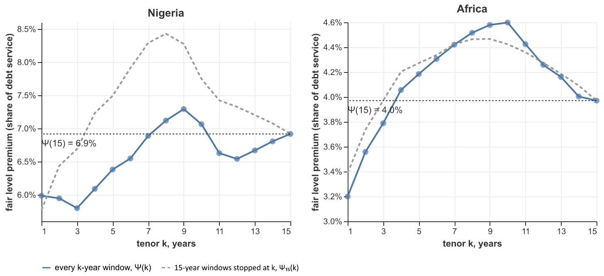

# The cost of the liquidity leg: the tenor profile of the fair premium

*Proposal for cell 10 of `notebooks/draft.ipynb` ("The cost of the liquidity leg"). It keeps the argument of your current draft of the cell and finishes it. Your current draft compares $\Psi(n)$ with $\Psi(\tau)$ and then defines the truncated $\Psi_n(\tau)$. This version prices **every tenor $k=1,\dots,15$ on its own pool of $k$-year windows from the same data**, for Nigeria from 1985 and for the full African pool from 1985, and sets each profile against the 15-year premium (6.9% and 4.0%). It also supersedes the stopped-window figure of `liquidity_leg_cell_20261006.md`, which is kept as the dashed reference curve.*

*Figure: `output/liquidity_leg_tenor_profiles.png`. Code: the two cells in §2, run in a script that reproduces the notebook's scope at cell 10. Every number below is printed by them.*

---

## 0. The profiles

**Nigeria, 1985–2024.** $\Psi(15)=6.92\%$ on 25 windows.

| $k$ | 1 | 2 | 3 | 4 | 5 | 6 | 7 | 8 | 9 | 10 | 11 | 12 | 13 | 14 | **15** |
|---|---|---|---|---|---|---|---|---|---|---|---|---|---|---|---|
| windows $N_k$ | 39 | 38 | 37 | 36 | 35 | 34 | 33 | 32 | 31 | 30 | 29 | 28 | 27 | 26 | 25 |
| $\Theta(k)$, yrs | .057 | .111 | .158 | .216 | .276 | .332 | .399 | .460 | .518 | .545 | .551 | .580 | .626 | .674 | .718 |
| windows short | 31% | 29% | 30% | 25% | 23% | 26% | 24% | 25% | 26% | 23% | 17% | 14% | 15% | 15% | 16% |
| $\Psi(k)$ | 5.99% | 5.95% | **5.80%** | 6.09% | 6.38% | 6.55% | 6.89% | 7.12% | **7.29%** | 7.06% | 6.63% | 6.54% | 6.67% | 6.81% | **6.92%** |
| $\Psi_{15}(k)$, stopped | 5.77% | 6.44% | 6.69% | 7.23% | 7.49% | 7.91% | 8.29% | 8.43% | 8.28% | 7.75% | 7.42% | 7.33% | 7.20% | 7.08% | 6.92% |

Range over the 14 shorter tenors: 5.80% ($k=3$) to 7.29% ($k=9$). Mean 6.55%. **3 of 14 lie above 6.92%** ($k=8,9,10$), and by at most 0.37 points.

**African pool, 1985–2024.** $\Psi(15)=3.97\%$ on 1,055 windows.

| $k$ | 1 | 2 | 3 | 4 | 5 | 6 | 7 | 8 | 9 | 10 | 11 | 12 | 13 | 14 | **15** |
|---|---|---|---|---|---|---|---|---|---|---|---|---|---|---|---|
| windows $N_k$ | 1768 | 1717 | 1666 | 1615 | 1564 | 1513 | 1462 | 1411 | 1360 | 1309 | 1258 | 1207 | 1156 | 1105 | 1055 |
| $\Theta(k)$, yrs | .030 | .066 | .103 | .144 | .181 | .219 | .256 | .292 | .325 | .355 | .368 | .377 | .391 | .396 | .412 |
| windows short | 36% | 36% | 36% | 36% | 36% | 36% | 36% | 36% | 36% | 36% | 34% | 31% | 29% | 27% | 26% |
| $\Psi(k)$ | **3.20%** | 3.56% | 3.79% | 4.06% | 4.18% | 4.31% | 4.42% | 4.52% | 4.58% | **4.60%** | 4.42% | 4.26% | 4.16% | 4.00% | **3.97%** |
| $\Psi_{15}(k)$, stopped | 3.39% | 3.74% | 3.97% | 4.20% | 4.27% | 4.34% | 4.42% | 4.46% | 4.47% | 4.42% | 4.36% | 4.27% | 4.19% | 4.09% | 3.97% |

Range over the 14 shorter tenors: 3.20% ($k=1$) to 4.60% ($k=10$). Mean 4.15%. **11 of 14 lie above 3.97%**, by at most 16% of the premium.



What the two profiles say, in one line each:

- **Nigeria.** The 15-year premium sits *above* most of its shorter tenors. Failure before maturity is close to neutral for the Facility, and slightly favourable.
- **Africa.** The 15-year premium sits *below* almost all of its shorter tenors. That is because the long tenor is the one where purchasing power parity (PPP) has had time to work. Failure before maturity costs the Facility something, but little: the whole profile lies within 4.0% to 4.6% from $k=4$ on.

---

## 1. The proposed markdown cell

Your paragraphs are kept where they were complete, with typos fixed. The fragments at the end of your draft ("to understand whether…", "In order to see whether…\bar\lambda…weighing the losses") are finished into the "premium with failures" and "two profiles" parts. The $\Theta$-versus-annuity paragraphs that closed the draft now open it, because they set up the question the rest answers.

```markdown
## The cost of the liquidity leg

If a covered project weren't subject to any risk other than the currency mismatch, the cover provided by the Facility would ensure that the project makes it to maturity without defaulting. In that case the project would pay $n$ years of premiums, each a fraction $\Psi(n)$ of the annual debt service payment, and in expectation the Facility would pay out $\Theta(n)$. At the Facility's cost of capital $\rho$, $\Theta(n)$ up front is equivalent to an annual payment of $\Psi(n)$: $\Psi(n)A_{n,\rho}=\Theta(n)$.

The conversion between the two uses an annuity factor at the Facility's discount rate, because it is on the Facility's balance sheet that the lump sum $\Theta$ is being converted into an annuity. For the Nigerian example we took that rate to be 5%. Compared with the hard currency cost of capital of a Nigerian project, that is unreasonably low. But to the Facility providing the cover, it isn't.

To see why, consider the alternative in which the Facility asks for $\Theta$ up front. To finance that payment the borrower would have to borrow it at its own cost of capital $r$, in excess of 10% a year for a project in Nigeria. At that rate $A_{15,10\%}=7.61$, and debt service would rise by 9.4% rather than 6.9%. That approach makes the lender take credit risk on an additional amount $\Theta$, which is unnecessary and more expensive. The Facility, by spreading the premium in instalments, only takes the borrower's credit risk to the extent that a project which fails early leaves it worse off than one that survives. The rest of this section shows that this extent is small, and that it is governed by one thing: how the fair premium for shorter tenors compares with the fair premium for the full tenor.

**A failure ends the cover.** The balance of the experience account accrues interest at $\rho$ when positive, and costs the Facility the same rate when it is negative and the project is drawing on the Facility's liquidity. Fix the tenor of the debt at $n$, and let $\tau<n$ be the year in which the project defaults on account of risks the cover does not price (construction, operations, the sponsor). Both the Facility's income and its loss change. In present value at the base date, the Facility will have collected $A_{\tau,\rho}\Psi(n)$ in premiums. There is no further debt service to support and no commutation at maturity: what it is left with is the experience account as it stands, a loss of $(-V_w(\tau))^+$ if the account is in deficit. Whether an early default costs the Facility money therefore hinges on whether
$$
\Psi(n) \;\gtrless\; \psi_w(\tau) \;\equiv\; \frac{(-V_w(\tau))^+}{A_{\tau,\rho}},
$$
the level premium that would have been needed to pay for the liquidity outstanding at $\tau$. By the definition of $\Psi(n)$, the Facility breaks even, on average over the pool, on projects that make it to maturity.

Consider the Nigerian window starting in 1985. In the first year the exchange rate moved against the project's naira revenues, and in 1986 the experience account would have been 0.26 debt service payments in the red: $X$ had fallen 25.5% below its 1985 level. If the project defaults shortly thereafter, the Facility will have received one premium of $\Psi = 6.9\%$ of a debt service payment and forfeit the 0.26 it provided in emergency liquidity. The liquidity is the bigger of the two by almost a factor of four: discounted to the base date, the Facility is out $(-V_w(1))^+ = 0.24$ years of debt service against premiums worth $A_{1,\rho}\Psi = 0.07$. For this window $\psi_w(\tau)>\Psi$ for every $\tau$ from 1 to 9. The Facility makes a loss on a project that defaults at any point between 1986 and 1994, and the loss deepens as the drawings accumulate, peaking for a default in 1993 at 1.12 years of debt service net of the premiums received (in present value at the base date). The Facility only comes out ahead from $\tau=10$, as the 1995–98 recovery of $X$ pays down the outstanding liquidity: narrowly in 1995 (premiums of 0.53 against 0.49 outstanding), and with nothing outstanding at all from 1996 onwards, after which every further premium is a gain. A project that survives to maturity leaves the Facility 0.72 years of debt service in premiums and commutes with $V_w=+3.33$ returned to it.

**From the window to the pool.** One window says little; the 1985 window happens to start just ahead of a fall in $X$. What matters is whether projects that default after $\tau$ years systematically need a higher annual premium to cover the liquidity they have drawn than projects that remain solvent through maturity. Averaged over a pool, $\psi_w(\tau)$ becomes the fair level premium for a tenor of $\tau$ years:
$$
\Theta(\tau) \;=\; \frac{1}{N_\tau}\sum_{w\in\mathcal{W}_\tau} (-V_w(\tau))^+ ,
\qquad
\Psi(\tau) \;=\; \frac{\Theta(\tau)}{A_{\tau,\rho}} ,
$$
where $\mathcal{W}_\tau$ is the set of all $\tau$-year windows in the data and $N_\tau$ their number. A project that fails in year $\tau$ of a 15-year loan leaves the Facility exactly where a $\tau$-year cover would have at maturity: $\tau$ premiums collected and the experience account's deficit written off. So the expected cost of a failure in year $\tau$ is priced by the same data, and by the same burning-cost estimate, as a $\tau$-year contract.

The comparison that decides the cost of the liquidity leg is therefore between $\Psi(n)$ and the $n-1$ fair premiums for the shorter tenors, $\Psi(1),\dots,\Psi(n-1)$, estimated on the same data. @fig-tenor-profiles plots them for Nigeria and for the African pool, both from 1985.

**The premium with failures.** Suppose each project defaults with probability $\bar\lambda$ a year, independently of its path of $X$, so that the cover stops at the end of year $\tau$ with probability $f_\tau=(1-\bar\lambda)^{\tau-1}\bar\lambda$ for $\tau<n$, and runs to maturity with $f_n=(1-\bar\lambda)^{n-1}$. The Facility breaks even when expected premiums equal expected losses, $\sum_\tau f_\tau\big(\psi^* A_{\tau,\rho}-\Theta(\tau)\big)=0$, so
$$
\psi^* \;=\; \frac{\sum_{\tau=1}^{n} f_\tau\,\Theta(\tau)}{\sum_{\tau=1}^{n} f_\tau\,A_{\tau,\rho}}
\;=\; \sum_{\tau=1}^{n}\omega_\tau\,\Psi(\tau),
\qquad
\omega_\tau \;=\; \frac{f_\tau A_{\tau,\rho}}{\sum_{s} f_s A_{s,\rho}} .
$$
The premium that allows for failure is a weighted average of the fair premiums for the $n$ tenors. Each tenor is weighted by the probability that the cover stops then, times the premiums the Facility would have collected by then. Two things follow. First, whatever the law of the failure year, as long as it is unrelated to $X$,
$$
\min_{\tau\le n}\Psi(\tau) \;\le\; \psi^* \;\le\; \max_{\tau\le n}\Psi(\tau).
$$
The cost of the liquidity leg is bounded by the tenor profile alone, before anything is said about how likely projects are to fail. Second, survival to maturity carries most of the weight even at high hazards, because $A_{15,\rho}=10.4$ against $A_{1,\rho}=0.95$. At $\bar\lambda=5\%$, half of all projects fail before maturity, but $\omega_n=0.65$.

**The two profiles.** For Nigeria the fourteen shorter tenors price between 5.8% ($\tau=3$) and 7.3% ($\tau=9$), with a mean of 6.55%. Only three of them, $\tau=8$ to $10$, lie above the 15-year premium of 6.9%, and by at most 0.4 points. Those are the tenors that end in the trough after the naira's 1999 devaluation, before the recovery. The 15-year premium is above most of the profile, so allowing for failure barely moves it, and moves it *down*: $\psi^*=6.90\%$, 6.87%, 6.83% and 6.78% for $\bar\lambda=1\%$, 3%, 5% and 8%, against 6.92% without failure. However failure is distributed in time, $\psi^*$ lies between 5.8% and 7.3%, a spread of between 100bp and 126bp against 120bp at maturity.

For the African pool the profile is a hump. It rises from 3.2% at one year to a peak of 4.6% at ten years and falls back to 4.0% at fifteen; eleven of the fourteen shorter tenors price above the 15-year premium. The shape has two halves. At short tenors the premium is a level stream from the first year, while the deficit is built up out of shortfalls one year at a time, so the premium runs ahead of the loss. Up to ten years, the share of windows that end short is flat at 36%: the windows that are going to recover have not yet had time to. After ten years that share falls to 26% at fifteen, as PPP brings $X$ back. The 15-year tenor is the one where mean reversion has had most time to work, so it is close to the cheapest. But the hump is low: from $\tau=4$ on, the whole profile lies between 4.0% and 4.6%. Whatever the law of the failure year, $3.2\%\le\psi^*\le4.6\%$, or at most 80bp against 69bp. With a constant hazard, $\psi^*=3.99\%$, 4.04%, 4.07% and 4.11% for $\bar\lambda=1\%$, 3%, 5% and 8%. Even if half of all projects fail before maturity for reasons that have nothing to do with the currency, the premium rises by 2.6%, from 3.97% to 4.07% of debt service, and the spread from 69bp to 71bp.

**Truncation and tenor.** The draft's first instinct was to stop each of the $N=\vert\mathcal{W}_n\vert$ fifteen-year windows at $\tau$, giving $\Psi_n(\tau)$, rather than to price $\tau$-year contracts on the larger pool $\mathcal{W}_\tau$. Because the account carries at $\rho$, a fifteen-year window stopped at $\tau$ *is* the $\tau$-year window with the same country and base date. So $\Psi_n(\tau)$ is $\Psi(\tau)$ estimated on the subset of $\tau$-year windows that also have fifteen years of data ahead of them, and leaves out the most recent base dates. The dashed lines in @fig-tenor-profiles show it. For the African pool the two curves all but coincide, and $\psi^*$ differs by at most 0.01 points between them. For Nigeria they do not: the 25 fifteen-year windows include the four, with base dates 1995–98, that run into the 1999 devaluation at mid-tenor, and leave out the fourteen base dates since 2010. Stopped at $\tau$, the Nigerian windows give a profile up to 8.4% and $\psi^*$ up to 7.2% at $\bar\lambda=8\%$. That is the conservative reading of one country's history; the pool is not sensitive to it.

**Correlated failures.** All of this assumes that failures are unrelated to the path of $X$. In practice the shocks that devalue the currency also strain the offtaker, so failures are likely to cluster when the project is drawing. The bound above then no longer holds mechanically. But failing while the account is in deficit is costly to the Facility only if the deficit would otherwise have been repaid. In the windows that end short anyway, a failure cuts off a loss that would have reached maturity.

**What a failure is not.** A project that can *choose* when to leave the cover is a different matter. One whose experience account has built up a surplus gains from refinancing and taking its escrow with it. One midway through a deficit gains from walking away from the sweep. Either choice falls on the Facility at the worst time, and neither can be priced with a hazard. Both are removed by contract: the premium is payable for the life of the loan, with a make-whole on prepayment, and the obligation to repay the deficit out of later surpluses survives any early termination.
```

---

## 2. The proposed code cells

The cells assume the notebook's scope at cell 10: `cover`, `n`, `rho`, `alt`, `pd`, `BLUE` and `nga` (cell 8), plus `df`. `POOL_START` is only defined in cell 13, so either move its definition up to cell 0 or replace it here with `1985`. They use only `cover`, not `default_risk`.

**Computation cell** (after the markdown, `include: false`):

```python
#| include: false
# The cost of the liquidity leg: the fair level premium for every tenor up to n,
# on the same data as the n-year price. For each tenor k the pool is every
# rolling k-year window in the sample -- W_k, larger the shorter k is -- and the
# premium is the one the paper would quote for a k-year loan, Psi(k) =
# Theta(k) / A(k, rho). Alongside it, the same windows' losses restricted to
# the (country, close) pairs of the n-year pool W_n: that is Psi_n(k), the
# n-year windows truncated at k, because with the account carried at rho a
# flow's weight (1+rho)^-k does not depend on the tenor of the window it is in.
import numpy as np


def tenor_profile(data, start_year=None):
    """Psi(k) on W_k and Psi_n(k) on W_n, k = 1..n, from one sample."""
    keys_n = cover.window_balance(cover.window_panel(data, n=n, start_year=start_year), rho)
    keys_n = set(zip(keys_n.iso3, keys_n.window_start))
    rows = []
    for k in range(1, n + 1):
        bal = cover.window_balance(cover.window_panel(data, n=k, start_year=start_year), rho)
        in_n = [key in keys_n for key in zip(bal.iso3, bal.window_start)]
        p = cover.price(bal, k, rho)
        rows.append({"k": k, "N": p["n_windows"], "theta": p["theta"], "psi": p["psi"],
                     "p_loss": p["p_loss"],
                     "psi_trunc": float(-bal.loc[in_n, "loss"].mean()) / cover.annuity(k, rho)})
    return pd.DataFrame(rows)


tenors = pd.concat([tenor_profile(nga).assign(pool="Nigeria"),
                    tenor_profile(df, start_year=POOL_START).assign(pool="Africa")],
                   ignore_index=True)

for name, t in tenors.groupby("pool", sort=False):
    psi_n, short = float(t.psi.iloc[-1]), t[t.k < n]
    print(f"{name}: Psi({n}) = {psi_n:.2%};  k < {n}: {short.psi.min():.2%} (k = {short.k[short.psi.idxmin()]}) "
          f"to {short.psi.max():.2%} (k = {short.k[short.psi.idxmax()]}), mean {short.psi.mean():.2%}, "
          f"{int((short.psi > psi_n).sum())} of {len(short)} above Psi({n})")
    print(t[["k", "N", "theta", "psi", "p_loss", "psi_trunc"]].to_string(
        index=False, formatters={"theta": "{:.3f}".format, "psi": "{:.2%}".format,
                                 "p_loss": "{:.0%}".format, "psi_trunc": "{:.2%}".format}))

# The premium once projects fail at a constant annual hazard lam, independently
# of X: a weighted average of the stopped premiums, psi* = sum_k w_k Psi(k),
# w_k proportional to f_k A(k, rho), where f_k is the chance the cover stops at
# the end of year k (k = n: failure in the last year, or survival).
A_k = np.array([cover.annuity(k, rho) for k in range(1, n + 1)])


def psi_star(psi_k, lam):
    f = (1 - lam) ** np.arange(n) * lam
    f[-1] = (1 - lam) ** (n - 1)
    return float((f * A_k * psi_k).sum() / (f * A_k).sum())


for lam in (0.01, 0.03, 0.05, 0.08):
    print(f"lambda = {lam:.0%}, fails before maturity {1 - (1 - lam) ** (n - 1):.0%}:  " + ";  ".join(
        f"{name} psi* = {psi_star(t.psi.to_numpy(), lam):.2%} "
        f"(stopped 15-yr windows {psi_star(t.psi_trunc.to_numpy(), lam):.2%})"
        for name, t in tenors.groupby("pool", sort=False)))
```

It prints the two tables in §0 and:

```
Nigeria: Psi(15) = 6.92%;  k < 15: 5.80% (k = 3) to 7.29% (k = 9), mean 6.55%, 3 of 14 above Psi(15)
Africa: Psi(15) = 3.97%;  k < 15: 3.20% (k = 1) to 4.60% (k = 10), mean 4.15%, 11 of 14 above Psi(15)
lambda = 1%, fails before maturity 13%:  Nigeria psi* = 6.90% (stopped 15-yr windows 6.97%);  Africa psi* = 3.99% (stopped 15-yr windows 3.99%)
lambda = 3%, fails before maturity 35%:  Nigeria psi* = 6.87% (stopped 15-yr windows 7.06%);  Africa psi* = 4.04% (stopped 15-yr windows 4.04%)
lambda = 5%, fails before maturity 51%:  Nigeria psi* = 6.83% (stopped 15-yr windows 7.14%);  Africa psi* = 4.07% (stopped 15-yr windows 4.07%)
lambda = 8%, fails before maturity 69%:  Nigeria psi* = 6.78% (stopped 15-yr windows 7.24%);  Africa psi* = 4.11% (stopped 15-yr windows 4.12%)
```

The spreads quoted in the cell ($\Delta r$ on the 15-year loan at $r=10\%$, from `cover.equivalent_rate`): 5.80% → 100bp, 7.29% → 126bp, 6.92% → 120bp; 3.20% → 56bp, 4.60% → 80bp, 3.97% → 69bp.

**Figure cell:**

```python
#| label: fig-tenor-profiles
#| fig-cap: "The fair level premium $\\Psi(k)=\\Theta(k)/A_{k,\\rho}$ for every tenor $k$ up to 15 years, each priced on all rolling $k$-year windows in the data from 1985 (solid). Left: Nigeria, from 39 one-year windows down to the 25 fifteen-year ones. Right: every African country in the panel, 1,768 down to 1,055. Dotted: the 15-year premium, 6.9% and 4.0%. Dashed: the 15-year windows stopped at $k$, i.e. the same premium estimated only on base dates with fifteen years of data ahead of them. If projects fail for reasons unrelated to $X$, the premium that breaks even is a weighted average of the solid curve, whatever the law of the failure year."
prof = tenors.melt(id_vars=["pool", "k", "N"], value_vars=["psi", "psi_trunc"],
                   var_name="curve", value_name="premium")
CURVES = {"psi": "every k-year window, Ψ(k)", "psi_trunc": "15-year windows stopped at k, Ψ₁₅(k)"}
prof["curve"] = prof.curve.map(CURVES)
psi_n = tenors[tenors.k == n].set_index("pool").psi


def tenor_panel(name):
    d = prof[prof.pool == name]
    x = alt.X("k:Q", title="tenor k, years", scale=alt.Scale(domain=[1, n]),
              axis=alt.Axis(values=list(range(1, n + 1))))
    y = alt.Y("premium:Q", title="fair level premium (share of debt service)",
              axis=alt.Axis(format=".1%"), scale=alt.Scale(zero=False))
    colour = alt.Color("curve:N", title=None, legend=alt.Legend(orient="bottom"),
                       scale=alt.Scale(domain=list(CURVES.values()), range=[BLUE, "#999999"]))
    dash = alt.StrokeDash("curve:N", legend=None, scale=alt.Scale(domain=list(CURVES.values()), range=[[1, 0], [4, 3]]))
    lines = alt.Chart(d).mark_line(strokeWidth=2).encode(x=x, y=y, color=colour, strokeDash=dash)
    dots = alt.Chart(d[d.curve.str.startswith("every")]).mark_point(
        filled=True, size=50, color=BLUE).encode(
        x=x, y=y, tooltip=["k", "N", alt.Tooltip("premium:Q", format=".2%")])
    rule = alt.Chart(pd.DataFrame({"y": [psi_n[name]]})).mark_rule(
        color="#333333", strokeDash=[2, 2]).encode(y="y:Q")
    label = alt.Chart(pd.DataFrame({"k": [1], "y": [psi_n[name]]})).mark_text(
        align="left", dy=12, color="#333333").encode(
        x="k:Q", y="y:Q", text=alt.value(f"Ψ(15) = {psi_n[name]:.1%}"))
    return (lines + dots + rule + label).properties(width=300, height=240, title=name)


alt.hconcat(tenor_panel("Nigeria"), tenor_panel("Africa")).resolve_scale(y="independent")
```

---

## 3. Notes

1. **Why the tenor curve and not the truncated one.** The identity "$\psi^*$ is a weighted average" is exact in-sample for the truncated curve $\Psi_n(\tau)$ (`default_risk.price_with_default` reproduces it). The tenor curve $\Psi(\tau)$ estimates the same expected losses $\mathbb{E}[(-V_w(\tau))^+]$ on all the data rather than only on the base dates with 15 years ahead of them. That is the same burning-cost logic the paper uses for $\Psi(n)$ itself. The cell says this and shows both curves, so the reader can see that the choice matters only for Nigeria.
2. **The Nigerian curve was flatter than I expected.** The 14 base dates since 2010 carry much less loss at every tenor beyond one year: the windows with those base dates price at 5.0% at $k=2$ and at nothing at all from $k=12$. That is what pulls $\Psi(k)$ below the truncated curve. It also makes the Nigerian $\psi^*$ fall with the hazard on the tenor curve, but rise on the truncated curve (6.97% to 7.24%). The cell reports both. If you want a single conservative headline for Nigeria, use the truncated range (5.8%–8.4%).
3. **Knock-on edits.** Notation (cell 2): add $\Theta(\tau)$, $\Psi(\tau)$ on $\mathcal{W}_\tau$, $N_\tau$, $f_\tau$, $\omega_\tau$, $\bar\lambda$, $\psi^*$. Cell 12 (African pool) can cite the 3.2%–4.6% range and the 4.07% at $\bar\lambda=5\%$, or leave it all here.
4. **Calibration of $\bar\lambda$.** The values are illustrative: a sensitivity, not an estimate.
